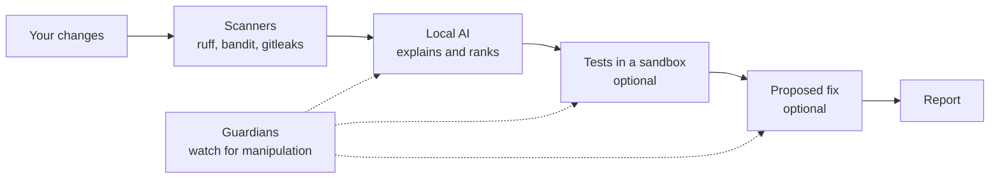

# git-reviewer

A code reviewer that runs entirely on your own computer and checks your changes before every
commit.

## What it does, in plain words

When you write code, you save your changes with git by making a commit. git-reviewer steps in just
before that and reads what you changed, the way a careful colleague would. Then it tells you about:

- **bugs**, such as a division that can crash on an empty list;
- **security holes**, such as user input pasted into a shell command;
- **secrets** you were about to commit by mistake, such as a password or an API key;
- if you ask, whether **your tests still pass**, and a **proposed fix**.

Each problem comes with its file, its line, how serious it is, and why it matters.

## Why use it

- **Catch mistakes before they are saved**, not after they reach GitHub or production.
- **Your code stays private.** The AI runs on your machine through Ollama. Nothing goes to the
  internet: no cloud AI, no account, no telemetry.
- **Safe even on code you don't trust.** Reviewing someone else's branch means reading code that
  could be booby-trapped: hidden text that tries to trick the AI, or a test that tries to steal
  your SSH keys. git-reviewer is built on the assumption that the code it reads is hostile.
- **Free.** It uses free local models, so there is no subscription and no API bill.

## Built with

| Part | Technology | Why |
|---|---|---|
| Language | Python 3.12, uv | Dependencies locked with hashes in `uv.lock` |
| Command line | Typer | `git-reviewer review`, `doctor`, `install-hook` |
| Workflow | LangGraph | The review is a graph of steps: the program, not the AI, picks the next step |
| AI | Ollama, langchain-ollama, qwen2.5-coder 7b and 14b | Runs offline on your machine |
| AI answers | Pydantic | Every AI answer must match a strict format, or it is thrown away |
| Scanners | ruff, bandit, gitleaks | Bugs, security issues and secrets, found by fixed rules |
| Sandbox | Docker | Runs the tests of untrusted code with no network |
| Quality | pytest, GitHub Actions, pip-audit | Tests, security scan and dependency audit on every push |

## How it works



1. **Read the change**: what you staged, or a branch with `--range main..feature`.
2. **Scanners first.** ruff, bandit and gitleaks check the changed files. They are the source of
   truth, because no text can talk them out of a finding.
3. **The AI explains.** The local model explains the findings, ranks them and adds what the
   scanners missed. A finding that does not point to a line you added is dropped.
4. **Guardians watch.** Three separate checkers look for manipulation. The anti-injection guardian
   looks for text that tries to steer the AI, the execution guardian for tests that try to harm
   your machine, and the patch auditor for a fix that sneaks something in.
5. **Tests in a sandbox** (`--run-tests`): your project's pytest and ruff, run inside Docker.
6. **A fix** (`--fix`): up to 3 attempts. Each one is checked by rules, tested in the sandbox and
   audited, then shown to you in full.

### The logic behind it

One idea runs through the design: **treat the code under review as an attacker, and the AI as
something that can be fooled.**

- **The AI has no hands.** It cannot run commands or touch files. It can only answer in a strict
  format, and an answer that breaks the format is rejected, never patched up.
- **Rules beat the AI.** The scanners and fixed rules have the last word. Guardians can raise an
  alert or block, but never approve.
- **When in doubt, stop.** A guardian that crashes, times out or answers nonsense counts as a block.
- **A trap word.** The AI's instructions hide a secret word. If it shows up in the answer, the AI
  was manipulated, and the review is blocked.
- **Untrusted code runs in a box**: no network, no admin rights, a read-only copy of your code, and
  hard limits. Without Docker, the tests don't run at all.
- **Nothing happens behind your back.** A fix is applied only after you type `yes`, and
  git-reviewer never commits or pushes.

## In numbers

| Number | What it means |
|---|---|
| **1,186** | automated tests, all passing |
| **109** | of them are attack tests (prompt injection, path traversal, network access, reading `~/.ssh`, fork bomb, infinite loop, symlink escape), each proving the attack fails |
| **20 / 20** | hidden instructions caught by the anti-injection guardian |
| **20 / 20** | dangerous tests caught by the execution guardian |
| **18 / 20** | malicious fixes caught by the patch rules and auditor together |
| **0 / 7** | false alarms from the patch checks on clean fixes (the other two guardians: 4 / 7 and 2 / 7) |
| **about 2 min** | to review a 53-line commit on a 16 GB MacBook M1 Pro |
| **1 CPU, 1 GB, 256 processes, 300 s** | the sandbox limits for each run, with no network |
| **0** | network calls, except to Ollama on your own machine |

**Why these choices:**

- **Two models.** The 7b writes the review because it is fast. The 14b runs the guardians: it
  caught 20/20 hidden instructions, against 15 or 16 for the 7b and 9 for `llama3.1:8b`, with no
  more false alarms than the 7b.
- **A 12,288-token memory for the guardians.** At 32,768 tokens the 14b needs 15 GB, and part of it
  falls back to the CPU, about ten times slower. At 12,288 it needs 11 GB and fits on the GPU of a
  16 GB Mac. Its verdicts were the same.
- **Scanners before the AI.** They give the same answer every time and can't be persuaded; an AI
  can.

**Be honest about the limits.** The guardians were measured on 60 plain attacks and 21 clean
samples, the same ones they were tuned on, so expect them to catch less in real use. They also
raise false alarms on changes that talk about security or AI prompts. The patch checks still miss
a weak password hash and an incomplete redirect check. And `git commit --no-verify` skips the
review. Details are in [SECURITY.md](SECURITY.md) §7 and §8.

## Quick start

You need [uv](https://docs.astral.sh/uv/), git 2.40 or later,
[gitleaks](https://github.com/gitleaks/gitleaks), [Ollama](https://ollama.com) and Docker.

```
git clone <this repository's URL> ~/.local/share/git-reviewer
cd ~/.local/share/git-reviewer
uv sync --locked --no-dev --no-editable
ollama pull qwen2.5-coder:7b
ollama pull qwen2.5-coder:14b
docker build -t git-reviewer-sandbox:0.1 sandbox/
```

The command is `~/.local/share/git-reviewer/.venv/bin/git-reviewer`; you can link it into
`~/.local/bin`. Then, in your project:

```
git-reviewer doctor
git-reviewer review
git-reviewer install-hook
```

`doctor` checks that everything is ready, `review` reviews what you staged, and `install-hook`
reviews automatically before every commit. Add `--run-tests` or `--fix` to `review` for the tests
and a fix.

## More

- [docs/USAGE.md](docs/USAGE.md): every command, setting and exit code, the hook, and the sandbox.
- [SECURITY.md](SECURITY.md): the threat model and the full measurements.
- [docs/ARCHITECTURE.md](docs/ARCHITECTURE.md): how the code is organized and why.
- [CHANGELOG.md](CHANGELOG.md): what is in each version.
