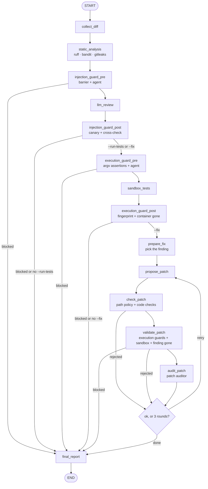

# git-reviewer: architecture plan

Status: phases 2 to 7 are implemented as described here. The guardians' measured detection and
false-positive rates are in SECURITY.md §7. Every design decision below states its security rationale; threat IDs
(`T-xx`) refer to [SECURITY.md](../SECURITY.md).

## 1. Scope

**v1 does:**
- review the staged diff (default) or a commit range (`--range main..feature`) of a Python project;
- run deterministic static analysis (ruff, bandit, gitleaks) and a local LLM review via Ollama;
- run the project's tests and linter in a Docker sandbox (`--run-tests`);
- propose a patch for a finding, validate it in the sandbox, show it, and apply it to the
  working tree only after explicit confirmation (`--fix`);
- install a pre-commit hook (blocking or warning mode).

**v1 does not:**
- support other languages (the analyzer and sandbox runner are behind interfaces so they can be added later);
- talk to any LLM other than a loopback Ollama instance, or to any other network service;
- read configuration from the reviewed repository (see §9);
- commit, push or stage anything, ever;
- support Windows (path and Docker semantics differ; revisit after v1).

## 2. Trust boundaries

```
 TRUSTED                                   | UNTRUSTED (data only, never instructions)
 ------------------------------------------+---------------------------------------------------
 CLI flags, user config, env of the user   | diff content: code, comments, strings, file names
 git-reviewer code and its pinned deps     | every file of the reviewed ref (tests, conftest.py,
 our own configs for ruff/bandit/gitleaks  |   pyproject.toml, .gitattributes, tool configs, symlinks)
 the sandbox image built from our Dockerfile | all LLM output (reviewer, patch author, guardians)
 the local Docker daemon, local Ollama     | everything produced inside the sandbox (test output,
                                           |   exit codes, linter output)
```

Rules that follow from the boundary:

1. Untrusted data flows *through* the graph but never chooses an effect. Only deterministic
   code decides what to run, what to write and whether to block.
2. Effects live in exactly five modules: `proc` (subprocess), `git.snapshot` (exports the reviewed
   files, or the whole reviewed tree, from git objects into a private temp dir for the scanners
   and the sandbox), `sandbox.docker`, `patch.apply` and `hook.install` (writes the pre-commit
   hook). Reports only go to standard output (§12).
   Nothing else may spawn a process or write outside a private temp dir. A unit test enforces this
   by scanning every other module for `subprocess`, `os.system`, `shutil.rmtree`, `open(..., "w"/"a"/"x")`,
   `Path.write_*`, `os.replace`, `os.rename`, `os.chmod` and `os.symlink`.
3. LLM-backed components (reviewer, patch author, guardians) can only *add* findings, alerts or
   blocks. Nothing they return can remove a block or authorize an action (T-30).

## 3. Package layout

```
src/git_reviewer/
  __init__.py          # forces LangChain/LangSmith tracing off before anything imports langchain (T-25)
  cli.py               # Typer app: review, install-hook, uninstall-hook, doctor
  config.py            # Pydantic settings: CLI > env (GIT_REVIEWER_*) > user config file; hard bounds
  models.py            # Pydantic models crossing boundaries: Finding, Report, GuardianVerdict, PatchProposal…
  proc.py              # the ONLY subprocess entry point (allowlist, absolute paths, no shell, clean env)
  sanitize.py          # control/ANSI/bidi stripping for display, secret masking
  audit_log.py         # allowlisted structured log fields (never code, output or secrets)
  git/
    diff.py            # collect diff, parse hunks into a DiffIndex {path -> added line numbers}
    refs.py            # validate refs with `rev-parse --verify --end-of-options`
    snapshot.py        # exports the reviewed files (scanners) or the whole reviewed tree (sandbox)
  static/
    tools.py           # ruff, bandit, gitleaks with OUR configs, suppressions ignored
    analyze.py         # findings on added lines + own checks (suppression markers, config edits)
    gitleaks.toml      # gitleaks built-in rules, nothing from the reviewed repo
  llm/
    ollama.py          # loopback URL check, model presence, cloud-model refusal, client factory
    prompts.py         # system prompts, nonce delimiters, canary token
    structured.py      # one call -> raw string -> strict Pydantic validation; no repair
  guardians/
    base.py            # fail-closed runner, verdict combination, decision log
    barriers.py        # deterministic checks: unicode, encoded blobs, AI-addressed phrases, docker argv
    injection.py execution.py patch_auditor.py
  sandbox/
    endpoint.py        # resolve and validate the local Docker socket
    docker.py          # build the docker argv, run, kill, remove, verify removal
    policy.py          # assertions on the argv actually built (execution guardian barrier)
    fingerprint.py     # hash of the user's working tree + .git control files
  patch/
    author.py          # LLM patch proposal (structured edits, not free-form diffs)
    policy.py          # deterministic path rules (final say)
    checks.py          # deterministic AST checks: new imports, network calls, weakened tests
    apply.py           # TOCTOU re-checks, then the validated content written to the working tree
  graph/
    state.py nodes.py build.py
  report/
    model.py           # the Report, exit codes
    render.py          # text / json renderers over sanitized data (printed, never saved)
  hook/
    install.py         # renders the hook script; install / chain / refuse / uninstall
sandbox/Dockerfile     # sandbox image: base pinned by digest, tools installed with hashes
sandbox/requirements.txt  # pytest and ruff for the image, pinned with hashes
scripts/eval_guardians.py   # guardian detection / false-positive metrics (dev tool, not shipped)
tests/
  unit/                # fast, no Docker, no Ollama (LLM calls faked)
  security/            # attack tests; Docker-backed ones marked `docker`
    fixtures/          # malicious DATA files, never collected or imported (see §15)
  guardians/
    datasets/{injection,execution,patch}/{malicious,clean}/*.json
```

## 4. CLI

| Command | Purpose |
|---|---|
| `git-reviewer review [--range A..B] [--run-tests] [--fix] [--format text\|json] [--mode block\|warn]` | Run the review graph. |
| `git-reviewer install-hook [--mode block\|warn] [--chain]` | Install the pre-commit hook (§13). |
| `git-reviewer uninstall-hook` | Remove our hook, restore a chained one. |
| `git-reviewer doctor` | Check git, Ollama (local, models present, not cloud), gitleaks and, as warnings since only `--run-tests` needs them, Docker (local endpoint, daemon, sandbox image) and leftover sandbox containers. |

`--fix` implies `--run-tests`: a patch is only shown after it passed the sandbox validation. It
is refused with `--hook` (a git hook cannot ask for the confirmation), never applied with
`--format json`, and applied in text mode only after a typed `yes` on an interactive terminal.
`--fix` does not change the exit code: it reflects the reviewed change, patched or not.

The tool never builds or pulls the sandbox image: that needs the network, and the spec allows no
network call except to Ollama. The user builds it once with a documented `docker build` command (§8.2).

Security blocks (barrier, guardian, canary, unsafe paths) exit 2 even in warn mode: warn mode only
turns findings and resource limits into warnings.

With `--run-tests`, tests that did not pass (failed, killed by a limit, could not run) also exit 1 in
block mode. The project's own linter run is informational: it covers the whole repository, and the
added lines are already checked by git-reviewer's ruff run.

Exit codes: `0` nothing at or above the threshold, `1` findings at or above the threshold (block mode),
`2` blocked by a security control (barrier, guardian, policy), `3` usage or configuration error,
`4` required environment missing (Docker or Ollama), never silently downgraded to a host run.

## 5. Review graph (LangGraph 1.2.x)

Checked against the LangGraph docs on 2026-10-23 (`langgraph` 1.2.16): `StateGraph(State,
context_schema=...)`, `add_node`, `add_edge`, `add_conditional_edges`, `START`/`END`,
`compile()`, `Command(goto=..., update=...)`, `recursion_limit` as a top-level config key.
Re-check before writing the graph in phase 3.



Design rules:

- **State.** A `TypedDict` (recommended by the docs for performance), but every value that
  crosses a trust boundary is a frozen Pydantic model validated when it is created.
  `blocks` and `alerts` use an append-only reducer (`operator.add` on tuples); no node has an
  API to remove one.
- **Routing is deterministic.** Conditional edges read only typed state (`blocks`, flags,
  `fix_attempts`), never LLM text. Any block routes straight to `final_report`.
- **Fix loop.** Each round appends to `fix_attempts`; a conditional edge stops after 3 rounds, and
  `recursion_limit` is set explicitly (60) as a second bound.
- **No persistent checkpointer.** Checkpoints would write code and diffs to disk. The graph is
  compiled without one; the patch confirmation happens in the CLI after the graph returns, so
  `interrupt()` is not needed.
- **Static analysis runs before any LLM** so its findings are fixed before untrusted text is
  shown to a model, and the cross-check has a ground truth.

## 6. Handling untrusted input

### 6.1 Diff collection
- `--range A..B` reviews what B adds on top of A: `git diff <merge-base(A,B)> B`, like a pull
  request. Any other form (`A...B`, a single ref) is a usage error.
- Refs from `--range` are validated with `git rev-parse --verify --end-of-options <ref>^{commit}`
  and then used as object IDs only (T-21).
- Diffs also pass `--no-relative --ignore-submodules=none --submodule=short` and
  `-c diff.suppressBlankEmpty=false`, so neither a branch's `.gitmodules` (`ignore = all`) nor local
  config can hide a change or shift line numbers; every hunk's line counts are checked against its
  header, and a mismatch stops the review.
- A path with a `.git` component (also `.GIT` or `.git.`, as case-insensitive file systems see them)
  stops the review: git never tracks one, so only a crafted tree has it, and it targets git itself.
- Staged mode records a hash of the index (`ls-files --stage -z`) read before and after the diff
  (they must match). Every later read of the index, for the scanners and for the sandbox copy, must
  find the same hash; a file staged during the review (by the user or an IDE) is never scanned or
  run without having been reviewed. In hook mode git locks the index; a range uses commit IDs.
- Every git call on untrusted content uses `--no-ext-diff --no-textconv --no-color`,
  `-c core.hooksPath=/dev/null -c core.fsmonitor=false`, `--attr-source=<empty tree>` (a
  branch's `.gitattributes` with `* -diff` or `binary` would otherwise make git print "Binary
  files differ" instead of the code; needs git 2.40+, checked by `doctor`), and an environment with
  `GIT_CONFIG_NOSYSTEM=1`, `GIT_CONFIG_GLOBAL=/dev/null`, `GIT_TERMINAL_PROMPT=0` and
  `GIT_OPTIONAL_LOCKS=0` (read-only commands must not rewrite `.git/index`, which the execution
  guardian fingerprints) (T-23).
- In hook mode, git runs the hook with `GIT_INDEX_FILE` (and possibly `GIT_DIR`, `GIT_WORK_TREE`)
  pointing at the index being committed; `git commit -a` and `git commit <paths>` use a temporary
  index. These variables are passed through to our git calls, otherwise the review would read the
  wrong index and miss what is actually committed.
- Hard limits (configurable downward only): diff size, number of files, line length. Over a limit
  the review stops with status "not reviewed" (exit 2 in block mode); it never truncates silently (T-35).
- Failure classes: resource limits (size, timeout) give "not reviewed" and follow `--mode`;
  unsafe paths and patch/file-list mismatches always exit 2, even in warn mode; unmerged paths
  exit 3; any other git failure exits 4 with git's own (sanitized) message. An unexpected crash
  exits 2, never 0 or 1. Until the LLM review exists (phase 3), `review` reports "not reviewed".
- Binary files are listed as "not analyzed" (T-36). Paths are checked for NUL, control characters,
  absolute paths and `..` before use.
- `DiffIndex` maps each file to the set of added or modified line numbers; every finding is checked
  against it.

### 6.2 Prompts
- The diff is wrapped in delimiters carrying a fresh random nonce:
  `<untrusted_diff nonce="9f2c…">…</untrusted_diff nonce="9f2c…">`. Any delimiter-like sequence
  inside the data is escaped, so the content cannot close the block (T-01).
- The system prompt states that the block is data, that instructions inside it must be ignored and
  reported as suspicious, and contains a per-run secret canary token (§10.2).
- Untrusted text is never placed in a system prompt.
- The model sees a numbered view of the diff (`  12 + code`, `  13 | code`, `     - code`): a small
  model gets line numbers right from it far more reliably than from hunk headers.
- What the model is shown (numbered diff + static findings) is capped by `max_review_chars`
  (default 60,000 characters). Over the cap, the LLM review is not performed and the status is
  "not reviewed"; the static findings are still reported.
- Ollama silently drops part of a prompt that does not fit its context window, system prompt and
  canary included. So the whole prompt must fit `model_context_tokens` (default 32,768, minimum
  8,192) with 4,096 tokens left for the answer (`num_predict`). Checked twice: before the call, at
  two UTF-8 bytes per token; after it, against the prompt token count Ollama reports. Either check
  failing means "not reviewed". The guardian, which reads the most hostile text, is sized at one
  byte per token, a strict upper bound (§10.1).

### 6.3 LLM output
- Ollama is called with `format=<JSON schema>` (constrained decoding) and temperature 0. The raw
  string is then validated by our own code: `Model.model_validate_json(raw, strict=True)` with
  `extra="forbid"`, bounded string lengths, bounded list sizes and enums for severities.
- We do not use lenient helpers (JSON repair, regex extraction, partial parsing, `include_raw`
  fallbacks). Invalid output = the component failed. For the reviewer, the status becomes "not
  reviewed" (exit 2 in block mode); for guardians it is a block (T-04).
- A finding whose `(file, line)` is not in `DiffIndex` is dropped and raises an alert (T-05).
- An answer that did not end normally (Ollama `done_reason` other than `stop`, e.g. cut at
  `num_predict`) is invalid output. `ollama_timeout_seconds` bounds the whole call, not only each
  network read.
- Only model failures (connection, HTTP, Ollama errors, timeout) and invalid output give "not
  reviewed". Any other exception is a bug in git-reviewer and crashes (exit 2), so it can never pass
  as "not reviewed" with exit 0 in warn mode.

### 6.4 Static analysis (phase 3)
- `git.snapshot` exports the reviewed version of every changed regular file (staged blobs, or blobs
  at the head of the range, read with `git cat-file --batch`) into a private temp dir (0700, files
  0600, created with `O_EXCL|O_NOFOLLOW`). Symlinks and submodules are never materialized; two paths
  colliding on a case-insensitive file system stop the review.
- Python files are recognized by suffix (`.py`, `.pyi`, `.pyw`) and by a `python` shebang, so a
  script named `bin/deploy` is scanned too.
- ruff: `--isolated --ignore-noqa --no-cache --no-respect-gitignore`, rules `E9,F,B,PLE`, and every
  file passed explicitly, so its default excludes (`dist/`, `build/`, `venv/`...) hide nothing.
  bandit: explicit files (no `.bandit` discovery), `--ignore-nosec` and an empty `--exclude=`: its
  default excludes match by substring, so `.git` would hide `.github/` and `CVS` would hide
  `CVSexport.py`. bandit's metrics must list every file it was given, or the analysis fails.
  gitleaks: our `gitleaks.toml` (built-in rules, but without the default global path allowlist,
  which skips `node_modules/`, lockfiles, PDFs and images), an empty ignore directory,
  `--ignore-gitleaks-allow`; a `.gitleaksignore` from the branch is never exported.
- A scanner that exits without its JSON output (even empty) is a failure (exit 4), never "no
  findings".
- Git paths are always literal (`--literal-pathspecs`): a file named `:(exclude)payload.py` would
  otherwise be pathspec magic that removes `payload.py` from the list of files to scan.
- Only findings on added lines are kept: a finding counts when any line of the statement it flags
  (the scanner's line range: bandit's `line_range`, ruff's `end_location`, gitleaks' `EndLine`) was
  added, and is then anchored on the first such line. bandit's B1xx checks (constants, default
  arguments, try/except) give the whole enclosing dict, function or block as their range, so for
  them the reported line alone counts. Scanners report a multi-line call or string
  on one of its lines, which may be unchanged (bandit's SQL check on the first line of a query
  whose `% value` was added below it). git-reviewer adds its own findings for added suppression
  markers (`# noqa`, `# nosec`, `gitleaks:allow`) and for edits to scanner configuration.
- Secret values never appear in findings: gitleaks messages name the rule only, bandit's
  hardcoded-password messages (which quote the value) are replaced, and every message is masked
  with the gitleaks values.
- Integrity checks, so nothing escapes the scanners silently (T-07, T-36):
  - a scanner finding beyond the last line git shows for a file means git and Python disagree on
    where lines end (a lone carriage return, an exotic encoding) → **block**;
  - a PEP 263 encoding declaration other than UTF-8, ASCII or Latin-1 → **block**: with `utf-7` or
    `unicode_escape`, Python decodes code that git, ruff and the model only see as a comment;
  - an added or changed executable binary (`.pyc`, `.pyo`, `.pyd`, `.so`, `.dylib`, `.dll`, `.whl`,
    `.egg`, `.zip`, `.pth`) → **block**;
  - any other binary file, or a Python file bandit could not parse → "not reviewed": part of the
    change was not analyzed. The barrier and guardian still run; the LLM review does not.
- The report shows how many files each scanner analyzed (`coverage`), so a scanner that saw nothing
  is visible.

### 6.5 Display
- Everything shown in a terminal goes through `sanitize.for_terminal()`: C0/C1 controls (except
  newline and tab) and ANSI/OSC sequences are removed, bidi and invisible characters are shown as
  `U+202E`-style escapes, length is capped. Rich markup in untrusted text is escaped (T-06).

## 7. Subprocess policy (`proc.run`)
- `shell=False` always; argv is a `list[str]`; `stdin=DEVNULL` unless data is passed explicitly.
- Allowlisted binaries: `git`, `docker`, `gitleaks`, `lsof` (only for the Ollama listener check, §9,
  with a fixed argv), plus `ruff` and `bandit` from our own virtualenv.
  They are resolved once at startup to absolute paths, from a fixed list of directories; relative
  PATH entries are rejected and a binary located inside the reviewed repository is refused (T-22).
- Environment: built from scratch (fixed `PATH`, `LANG=C.UTF-8`, the git variables of §6.1). The
  user's environment is never inherited; the only pass-throughs are the hook-mode git variables of
  §6.1 and, for one read-only `git config --get core.hooksPath` at hook installation (§13), the
  variables that locate the user's own git configuration (`HOME`, `XDG_CONFIG_HOME`,
  `GIT_CONFIG_GLOBAL`, `GIT_CONFIG_SYSTEM`, `GIT_CONFIG_NOSYSTEM`).
- Every call has a timeout and an output cap; untrusted values come after `--end-of-options` or `--` (T-21).

## 8. Sandbox

### 8.1 Workspace
- A private temp dir (`mkdtemp`, mode 0700) holds `tree/` and an empty `docker-config/`.
- `git.snapshot.export_tree` writes the reviewed tree into `tree/` straight from git objects: the
  index in staged and hook mode (the hook's `GIT_INDEX_FILE`), HEAD of the range otherwise. This
  replaces a `git worktree add`, which would write `.git/worktrees/<id>`, run checkout (and any
  filter configured for the repository) and create symlinks. The user's working directory is never
  mounted and nothing is written to the user's `.git`.
- Only regular files are copied (dirs 0755, files 0644 or 0755 so the sandbox user can read them;
  the private parent keeps other local users out). Symlinks and submodules are never materialized
  and are listed in the report notes (T-18). Paths are validated like diff paths (no `..`,
  absolute, control characters or `.git` component); an unsafe path anywhere in the tree is a
  security block (`execution.tree`), not just "tests not run". Limits: 20,000 files and 256 MiB,
  otherwise the tests are not run.
- Untracked files such as `.env` are never copied, since only git objects are read (T-11). The
  copy has no `.git`: tests that need git metadata fail.
- Cleanup in `finally` (the temp dir is removed); nothing else to clean up after a crash.

### 8.2 Image
- Built from `sandbox/Dockerfile`: base `python:3.12-slim` pinned by its multi-platform index
  digest, pytest and ruff installed from `sandbox/requirements.txt` with `--require-hashes` and
  wheels only, user `10001:10001`. The user builds it once (`docker build -t git-reviewer-sandbox:0.1
  sandbox/`, see the README); CI builds it the same way.
- A `.pth` file in the image's site-packages appends `/work/src` and `/work` to `sys.path`, after the
  standard library and the installed packages, and the runner uses `python -P` (no current
  directory in front). So the reviewed code is importable, but a `pytest.py`, `pluggy.py` or
  `json.py` in the repository cannot replace the real module and fake a result. Trade-off: a project
  module named like a standard-library module is not importable in the sandbox.
- The image name comes from the user config (`sandbox_image`, default `git-reviewer-sandbox:0.1`; an
  image ID `sha256:...` is accepted too). It is resolved to its local image ID once per review, that
  ID is what `docker run` gets, and it is checked again right before each run, so the image cannot
  change in the middle of a review. Anyone who could re-tag images already controls Docker, which is
  root-equivalent on the machine.
- **Dependencies of the reviewed project are never installed from the reviewed ref.** Installing them
  would run build code from the attacker with network access. The README documents how to build a
  derived image from a requirements file the user exports from a ref they trust (default: the base
  branch), wheels only and hashes required, so no `setup.py` runs during the build.
- Trade-off: if the reviewed diff changes dependencies, the tests run with the trusted set and may
  fail. The report says so explicitly ("dependency change detected: tests ran with base dependencies").

### 8.3 Container command
The argv built by `sandbox.docker`, asserted field by field by `sandbox.policy` before running (once
by the execution guardian, again inside the runner):

```
docker --host unix://<validated socket> run
  --rm --pull=never --init
  --name=gr-<run id>-<tool> --label=git-reviewer.run=<run id>
  --network=none
  --user=10001:10001
  --read-only --tmpfs=/tmp:rw,noexec,nosuid,nodev,size=256m
  --mount=type=bind,source=<tmp>/tree,target=/work,readonly
  --workdir=/work
  --cap-drop=ALL --security-opt=no-new-privileges
  --pids-limit=256 --memory=1g --memory-swap=1g --cpus=1
  --log-driver=none
  --env=HOME=/tmp --env=PYTHONDONTWRITEBYTECODE=1
  sha256:<local image id>
  timeout --signal=KILL <N>s python -P -m pytest -q -p no:cacheprovider --color=no
                         (or: ruff check --no-cache --output-format=concise .)
```

- `sandbox.policy` keeps its own copy of these options, apart from the builder: every option must
  be present exactly once and nothing else is accepted, so `-v`, `--privileged`, `--env-file`,
  `--network=host`, a second mount or a bare `--env NAME` (which copies the host's value) all stop
  the run. A unit test pins the option list literally (T-15).
- The mount source is checked on its own too, not just compared with what the builder planned: it
  must be `<temp dir>/git-reviewer-sandbox-*/tree` inside a 0700 directory of the current user. So a
  change that pointed the mount at the repository, the home directory or `/` is refused even if
  the builder and the plan agree.
- `--log-driver=none`: the output reaches us through the attached client only; Docker keeps no log
  file of it (it may quote secrets).
- The run is bounded twice: `timeout --signal=KILL` inside the container (it stops even if
  git-reviewer dies) and a host-side timeout (N + 30 s) on the docker client. `docker rm -f` runs in
  `finally`; the execution guardian then checks that no container with the run label remains
  (T-12, T-14). Output is capped at 4 MiB (an output flood stops the run) and the report keeps the
  last 8,000 characters, masked and sanitized.
- The Docker endpoint is resolved once by `sandbox.endpoint`: `DOCKER_HOST`, else the current
  context (`DOCKER_CONTEXT`, or `currentContext` in the Docker config file, nothing else of which is
  read), else `/var/run/docker.sock`. It must be a `unix://` socket owned by root or the user, in a
  directory others cannot write; `tcp://` and `ssh://` exit 2, because the code would leave the
  machine (T-17). Every docker call then gets `--host unix://<resolved socket>` and `DOCKER_CONFIG`
  pointing at the empty private dir, so the endpoint used is the endpoint validated.
- If Docker is missing, not running, or the image is not built, `--run-tests` exits 4 before the
  review starts. There is no host fallback (T-16).
- Test results are untrusted: test code can fake a pass (`os._exit(0)`, conftest hooks). They are a
  quality signal for the user, never a security decision (T-34). A pytest exit code 0 without its
  "N passed" summary line is reported as an error, which catches the bare `os._exit(0)` case.
- Tests run only after a completed review (they are skipped when the review is blocked or "not
  reviewed").

## 9. Configuration
- Sources, highest first: CLI flags, `GIT_REVIEWER_*` environment variables, the user config file
  (`~/.config/git-reviewer/config.toml`). **No configuration is read from the reviewed repository**
  in v1: a malicious branch could otherwise point `ollama_url` at a remote host or loosen limits (T-27).
- Keys: `ollama_url`, `reviewer_model`, `guardian_model` (separate from the reviewer, as the spec
  requires), timeouts, size limits, severity threshold, `sandbox_image` and
  `sandbox_timeout_seconds` (10 to 1,800, default 300). The sandbox's memory, CPU and process
  limits are fixed in code, not configurable. Security limits have hard upper bounds in code.
- Defaults to settle in phase 2: reviewer `qwen2.5-coder:7b` (fits a 16 GB machine; `:14b` if
  memory allows). The guardian model should come from a different model family, so an injection
  tuned for one model is less likely to fool both; the choice is driven by the red-team metrics.
- **Ollama checks at startup:** URL scheme `http`, no credentials, host resolving only to loopback
  addresses; model present in `/api/tags`; cloud models refused (`*-cloud` tags or a remote host
  reported by Ollama), since local Ollama would forward the code; a warning if Ollama listens on
  `0.0.0.0`, based on `OLLAMA_HOST` and `lsof -nP -iTCP:<port> -sTCP:LISTEN`; if `lsof` is missing, the
  warning says the check could not run (T-24).
- **Telemetry:** `git_reviewer/__init__.py` sets `LANGCHAIN_TRACING_V2`, `LANGCHAIN_TRACING` and
  `LANGSMITH_TRACING` to `false` and removes LangSmith API keys and endpoints from `os.environ` before
  any LangChain import. A test asserts it, and a test-wide socket guard fails on any non-loopback
  connection, and on the Ollama port itself: tests use a fake model (T-25). Note: `langsmith` is a
  transitive dependency of `langchain-core`; it is installed but its tracing is forced off.
- **Proxies:** the Ollama client runs in our own process and httpx honors `HTTP_PROXY`,
  `HTTPS_PROXY` and `ALL_PROXY` by default, which would send prompts (the code) to a proxy even with a
  loopback `ollama_url`. The client is created with `trust_env=False` and an explicit `base_url`
  (so `OLLAMA_HOST` cannot override it), and `__init__.py` also removes `*_PROXY`/`*_proxy`
  variables. Tested with `HTTPS_PROXY` set (T-24).

## 10. Guardians

### 10.0 Common runner
- Output schema (strict): `{verdict: "ok" | "suspect" | "block", reasons: [str ≤ 300 chars, ≤ 10],
  lines: [{file, line} ≤ 50]}`.
- `run_guardian()` wraps every call: exception, timeout, invalid JSON or schema violation → `block`
  with a reason code (fail-closed).
- Isolation: own system prompt, no tools, no reviewer history; it receives only its input bundle.
- Combination is monotonic: `final = max(deterministic, guardian)` over `ok < suspect < block`. A
  guardian can raise an alert (`suspect`) or block; its `ok` never lowers a deterministic decision.
- Every decision goes to the security report and the log: guardian, verdict, reason codes, line
  refs, duration. No code, no secrets (reasons are masked and truncated before display).

### 10.1 Anti-injection guardian
Before the review:
- Barrier, on every line shown to the model (added, unchanged, removed) and every file name:
  - bidi controls (U+202A–202E, U+2066–2069, U+200E/F, U+061C) and Unicode tag characters
    (U+E0000–E007F) → **block**: never legitimate in code;
  - other invisible or format characters (zero-width, joiners, variation selectors, Hangul fillers)
    → suspect: they also occur legitimately, e.g. in emoji sequences. A BOM at the start of a file
    is accepted;
  - base64 (≥ 40 chars) or hex (≥ 64 chars) runs that **decode to readable text** → suspect, and the
    decoded text is scanned for AI-addressed phrases. Runs that decode to random bytes (hashes,
    integrity values in lockfiles) carry no message and are ignored, to avoid flooding alerts;
  - AI-addressed phrases, after NFKC + casefold + invisible-character removal, in English, French,
    Spanish and German, also across three consecutive lines (split instructions) → suspect;
  - text imitating our data delimiters (`untrusted_…`, `nonce=`) → suspect;
  - a carriage return inside a line (not the CR of a CRLF ending) → **block**: git splits lines on
    LF only, but Python also ends a line at a lone CR, so code can hide in what git, the scanners'
    line mapping and the model see as a comment.
  - a word whose letters come from more than one script, after NFKC (homoglyphs: "ignore" with a
    Cyrillic or Armenian "o", fullwidth or mathematical letters mixed with Cyrillic, Cyrillic with
    Greek) → **suspect**, since no phrase pattern would match it. Kanji and kana count as one
    script. A word written entirely in look-alike letters of one script is not detected (T-07
    residual).
- Agent: called only when the barrier says "suspect" (a block is already final). It receives the
  flagged lines with one neighbour on each side, nonce-delimited, and may raise to "block". Line
  references it returns that it was not shown are dropped.
- The passages are sent in batches of at most 20,000 UTF-8 bytes, fewer when the context window is
  small (every token is at least one byte, so a batch always fits next to the system prompt and the
  answer). Nothing is truncated: more than 5 batches, or a single line too long for one batch, is a
  **block**, since the guardian could not see everything.

After the review:
- Canary: a random 128-bit token in the reviewer's system prompt; if it appears anywhere in the
  raw output → block. The delimiter nonce appearing in the output → suspect. Both are compared
  after decoding JSON escapes, NFKC, casefold and keeping only letters and digits, so `\u0043ANARY…`,
  `canary - 1F2E…` or fullwidth letters still match.
- Cross-check: for every static finding of severity ≥ medium, the reviewer output must mention that
  `file:line` without lowering it to info/low or calling it a false positive. Otherwise → alert
  "probable injection". Static findings are always in the report whatever the LLM says.

### 10.2 Execution guardian
Before the sandbox runs:
- Barrier: `sandbox.policy` asserts the exact argv of both runs (§8.3). One deviation → no run.
- Agent: reads the added and context lines of the changed test infrastructure: test files
  (`test_*.py`, `*_test.py`, anything under `tests/`, `test/`, `testing/`, `fixtures/`),
  `conftest.py`, `setup.py`, `setup.cfg`, `pyproject.toml`, `pytest.ini`, `pytest.toml`,
  `.pytest.toml`, `.pytest.ini`, `tox.ini`, `noxfile.py`, `*.pth`, `sitecustomize.py`,
  `usercustomize.py`, and `test*.txt` (pytest's default `--doctest-glob` runs their `>>>` lines).
  It flags network access, subprocesses, reads
  outside the repo, environment harvesting, `eval`/`exec`/`compile`, `__import__`/`getattr` chains,
  encoded payloads and tampering with the test run. Lines are sent in batches that fit its context
  (like the anti-injection agent); more than 5 batches, or a failure, is a block. A block means the
  tests are not run, even in the sandbox (defense in depth against container escapes). When no test
  infrastructure changed, the agent is not called.

After the sandbox runs (also when a run failed):
- The user's working directory fingerprint must equal the one taken before: content hashes of
  tracked files and untracked non-ignored files, `HEAD`, `index` and `config.worktree` of the
  current worktree, and `config`, `hooks/` and `info/` of the common git directory (a different
  directory in a linked worktree). Symlinks are hashed as their target text, never followed; a file
  that cannot be read is an error, never skipped. Nothing is expected to change, since nothing is
  written to the user's `.git`.
- No container with the run label exists (`docker ps --all --filter label=…`).
- Either check failing, or not being possible, is a block (exit 2, even in warn mode), and the
  block keeps the cause (for example "Docker did not answer in time").
- The report says whether a block came before the review ("not sent for review") or after it
  (execution guardian); after it, the review findings and the test results stay visible.

### 10.3 Patch auditor
- Separate component and prompt from the patch author (`guardians.patch_auditor`). It receives only
  the structured finding and the patch diff, never the author's explanation or reasoning.
- Checks: fixes only the announced finding; no new network call, process, dynamic code,
  dependency, unneeded import or obfuscation; does not weaken tests (removed or changed asserts,
  `skip`/`xfail`, relaxed tolerances, `try/except` that swallows errors, changed expected values);
  does not hide the problem instead of fixing it.
- "block" rejects the round, "suspect" keeps the patch with an alert shown next to it, a failure
  rejects it (fail closed). A rejection is shown as an alert in the security report: it does not
  block the review, whose change is not the patch.
- `patch.policy` and `patch.checks` run before it and have the final say: the auditor can reject
  what they accepted, never the reverse.

## 11. Patch flow
0. One finding is chosen: the most severe one of medium severity or more, in a Python file of the
   change, static findings before LLM findings at equal severity, skipping files the policy denies.
   No patch is attempted if the project's tests do not pass before it (nothing could be validated),
   or if the file is not UTF-8, has Windows line endings or is longer than 60,000 characters.
1. The author (the reviewer model, its own prompt with a canary) gets the finding and the
   reviewed version of that one file, numbered and nonce-delimited, plus why earlier rounds were
   rejected. It returns **structured edits** (`path`, `start_line`, `end_line`, `replacement`) on
   that file only; we build the unified diff ourselves with difflib, so a malformed diff never
   exists. Lines are counted like git (split on "\n" only).
2. `patch.policy` (deterministic, final): path must be a Python file of the diff, written with plain
   characters only (letters, digits, `.`, `_`, `-`, `/`); normalized with NFC
   and casefold (macOS file systems are case-insensitive, so `.GIT/config` is `.git/config`); no
   absolute path, `..`, NUL or control characters; `lstat` says regular file, not symlink; resolved
   path stays inside the repo. Denied whatever the diff says: `.git/`, hooks dirs (`.githooks/`,
   `.husky/`), CI (`.github/`, `.gitlab-ci.yml`, `.circleci/`, `Jenkinsfile`, `azure-pipelines.yml`,
   `.travis.yml`, `.pre-commit-config.yaml`), dependency and build files (`pyproject.toml`, `setup.py`,
   `setup.cfg`, `requirements*.txt`, `constraints*.txt`, `uv.lock`, `poetry.lock`, `Pipfile*`,
   `Makefile`, `Dockerfile*`), test infrastructure (`conftest.py`, `pytest.ini`, `pytest.toml`,
   `.pytest.toml`, `.pytest.ini`, `tox.ini`, `noxfile.py`),
   Python startup hooks (`sitecustomize.py`, `usercustomize.py`, `*.pth`), tool configs
   (`.git-reviewer*`, `.gitleaks.toml`, `.gitleaksignore`, `ruff.toml`, `.ruff.toml`, `.bandit`),
   files that editors and coding agents load automatically (`.envrc`, `.vscode/`, `.idea/`,
   `.devcontainer/`, `.claude/`, `.cursor/`, `CLAUDE.md`, `AGENTS.md`), and `.gitattributes`, `.gitmodules`.
3. Then, in this order, so that a patch failing a cheap deterministic check never runs, even in
   the sandbox: `patch.checks` (an encoding declaration other than UTF-8/ASCII/Latin-1 is refused,
   then both versions are parsed from bytes, as Python reads them, and compared: new risky import,
   third-party dependency or star import; new uses, with import aliases resolved, of
   eval/exec/os.system/os._exit/subprocess/socket/HTTP/decoding helpers, including
   `getattr(os, "system")` and getattr on computed names; long literals; invisible characters;
   catch-all `except`, also in a tuple; and in test files any removed or changed assertion or test,
   any new skip/xfail/SkipTest/skipTest, and any new early `return`/`raise` or constant condition
   inside a test; added lines longer than 300 characters, which the user could not read in full,
   are refused too); then the execution
   guardian (argv barrier, and the agent when the file is test infrastructure); then the sandbox
   run of pytest on the copy with the patch (the copy is restored to the reviewed version
   afterwards), followed by the fingerprint and leftover-container checks; then, for a scanner
   finding, the same scanner must report that rule fewer times in the patched file (a file the
   scanner cannot parse does not count as fixed); then the auditor. Guardian alerts on the patch
   ("suspect") are shown next to it and in the security report. Up to 3 rounds. Rejection reasons go back to the author inside nonce delimiters; from
   the tests, only pytest's `FAILED`/`ERROR` summary lines, sanitized and truncated, because test
   output is attacker-controlled. A canary leak by the author blocks the review.
4. The CLI shows the full diff (sanitized, invisible characters made visible), the author's
   explanation (labelled as such), the test result and any auditor alert, and asks for a typed
   `yes`. The diff is never masked: what the user reads is exactly what is written. A secret value
   found by gitleaks comes from the reviewed branch and can span lines (a crafted private key), so
   masking could hide an added line; a patch is therefore never offered when a detected secret
   value occurs in its file, its new content or its diff (checked when choosing the file, in
   `check_patch`, and again before display). Trade-off: no patch is proposed to remove a hardcoded
   secret; the user removes it, and rotates it. Only on an interactive terminal; never in hook mode or with `--format json` (the JSON
   carries the diff for display, never the raw new content).
5. Before writing: `patch.policy` again, then the working tree as it is now: no symlink on the path,
   a regular file inside the repository, and exactly the bytes that were reviewed (TOCTOU; a file
   with unstaged changes is not patched either). The exact content validated in the sandbox is
   written to a new file next to the target (`O_EXCL|O_NOFOLLOW`, same mode) and renamed over it:
   the rename replaces the path, so a symlink swapped in at the last moment is replaced, never
   followed. No `git apply`: it would run the filters selected by `.gitattributes`, and git 2.46
   crashes in `git apply` with `--attr-source`. Working tree only: nothing is staged, committed or
   pushed (a structural test forbids `git add`, `commit`, `push`, `update-index`, `update-ref`,
   `reset` and `stash` in the code).

## 12. Reports and logs
- `Report` (Pydantic) → renderers: text (default) and JSON (`--format json`), printed on standard
  output only. git-reviewer writes no report file: one inside the repository would be untracked,
  easy to commit with `git add -A`, and would change the execution guardian's fingerprint. Saving a
  report is the user's choice (a shell redirection, outside the repository). A "Security report"
  section lists every barrier and guardian decision.
- Secrets: gitleaks findings are captured in memory only. Their values are used to mask any text
  before display (LLM explanations, guardian reasons, test output), then dropped. A secret finding
  shows its rule and location, never the value.
- Logs: the `git_reviewer.audit` logger (`audit_log.event`) records guardian decisions with
  allowlisted fields only (event, source, verdict, counts, durations, rule ids, as numbers or short
  identifiers); free text from untrusted sources is never logged (T-26). It is silent unless the
  user's own Python logging configuration enables it.

## 13. Git hook
`git-reviewer install-hook [--mode block|warn] [--chain]` writes this script, rendered at install
time with the absolute path of the git-reviewer being run, single-quoted:

```sh
#!/bin/sh
# Installed by git-reviewer: reviews the staged changes before each commit.
# Mode: block (a finding at or above the threshold stops the commit).
# Skip once: git commit --no-verify
# Remove:    git-reviewer uninstall-hook
exec '/absolute/path/to/git-reviewer' review --hook --mode block
```

- Location: `<git common dir>/hooks/pre-commit`, so one hook serves every linked worktree.
  (`git rev-parse --git-path hooks` cannot be used: git-reviewer's hardened git calls set
  `core.hooksPath=/dev/null`.) A `hooks` path that is a symlink or not a directory is refused.
- `core.hooksPath` set in any configuration file (system, including `GIT_CONFIG_SYSTEM`; global,
  including `$XDG_CONFIG_HOME` and `GIT_CONFIG_GLOBAL`; repository), even to an empty value, means
  git never runs `.git/hooks`: a hook installed there would silently do nothing. Installing refuses
  and prints the exact line (absolute path, chosen mode) to add to that hook manager (husky, the
  pre-commit framework, a team setting). Configuration passed through the environment
  (`GIT_CONFIG_COUNT`, `GIT_CONFIG_PARAMETERS`) cannot be checked, so it is refused too. This is
  the only git call that reads the user's own configuration; `git config --get` runs nothing.
- An existing `pre-commit` is never overwritten. Without `--chain`, installing refuses and prints
  the line to add by hand. With `--chain`, it is kept as `pre-commit.chained-by-git-reviewer` and
  the new hook runs it first (`'.../pre-commit.chained-by-git-reviewer' "$@" || exit $?`), so its
  failure stops the commit before the review. The original is hard-linked to the new name (which
  fails if the name exists) and the new hook renamed over the old name: there is never a moment
  without a hook, and a failure only removes the extra link. Chaining is refused when the hook is
  not executable (git ignores it today; chaining would start running it) or reads its own name
  (`$0`, as husky v4 and overcommit do: renamed, it would silently do nothing). A hook that is a
  symlink or not a regular file is refused.
- git-reviewer's own hook is recognized only when the file is exactly a script it would write;
  one changed by hand is never replaced or removed. Re-installing (another mode, a new binary, the
  repository moved) keeps the chain, at the chained hook's current path. `uninstall-hook` works
  whatever `core.hooksPath` says: it removes git-reviewer's hook, or renames the chained one over
  it in one step, after checking the chained file is a regular file. A `pre-commit.chained-by-
  git-reviewer` without the hook that runs it (an interrupted install, a hook deleted by hand) is
  never ignored: install, uninstall and `doctor` say where it is and print the `mv` that restores it.
- Writing: a new file (`O_EXCL | O_NOFOLLOW`, mode 0755 less the umask; refused if the umask
  would leave it unreadable or not executable for its owner) is hard-linked into place, which fails
  if the name appeared meanwhile; only git-reviewer's own hook is ever replaced (by rename).
- The binary must be an absolute path to an executable outside the repository and every one of
  its worktrees (the hook serves them all), at every hop of a chain of symbolic links (the path
  given, each link where it physically lives, its folder resolved, and the resolved program): a
  file or a symlink there is content a checked-out branch controls, even when it is reached through
  a folder symlink such as `~/bin` pointing into a repository. A worktree git lists but that is missing is refused, with a hint to run
  `git worktree repair` or `prune`: it may have been moved by hand and still be in use. "Outside" is decided by file identity (device and inode of
  every parent), not by name, since macOS file systems ignore case and Unicode normalization. Like
  the binaries `proc` runs, neither the program nor its directory may be writable by group or
  others, nor the directory holding the path given (e.g. `~/.local/bin` with a symlink). A quote, newline or NUL in the binary or
  hooks path is refused (the script single-quotes them).
- Modes. `block`: findings at or above the threshold exit 1 and stop the commit. `warn`: findings
  and resource-limit "not reviewed" results never stop the commit; security blocks (exit 2) and an
  unusable environment (exit 4: Ollama, a model or gitleaks missing) still do, fail-closed. The
  user skips one commit with `--no-verify`.
- In hook mode: non-interactive, `--fix` and `--range` refused, no sandbox tests (`--run-tests` is
  a manual option, too slow for every commit). `GIT_INDEX_FILE` and the other hook variables of
  §6.1 are passed through, so the review reads exactly the index being committed (`git commit -a`
  and `git commit <paths>` use a temporary one).
- `--no-verify` skips the hook. The hook is a convenience for the user, not a security boundary.
- `doctor` says whether git really runs git-reviewer before each commit, and warns when it would
  not: the hook or its chained hook not executable, the binary gone (a deleted virtualenv, a
  pruned cache), the repository moved (the script names the chained hook's old path, so every
  commit fails until `install-hook` is run again), a parked chained hook, or a state it cannot read.

## 14. Supply chain and CI
- Runtime dependencies: `typer`, `pydantic`, `langgraph`, `langchain-ollama` (and their transitive
  deps). Dev: `pytest`, `ruff`, `bandit`, `pip-audit`. Anything else needs a written justification.
- `uv.lock` committed (it records hashes); installs use `uv sync --locked`.
- CI (GitHub Actions, added in phase 2): actions pinned by commit SHA, `permissions: contents: read`,
  `uv sync --locked`, ruff, pytest (unit + security, Docker available on the Linux runner), bandit on
  `src/`, pip-audit on the locked environment. gitleaks pinned by version and checksum.

## 15. Testing strategy
- `tests/unit`: pure logic, LLM calls faked. `tests/security`: one test per attack in the spec, each
  asserting the attack *fails* (blocked, contained, or rejected).
- **Malicious fixtures are data.** They live in `tests/security/fixtures/` and
  `tests/guardians/datasets/` as `.diff`, `.json` or `.txt` files (never `test_*.py`), excluded via
  pytest `norecursedirs`, and excluded from ruff, bandit and pyright. Only the sandbox ever executes
  them (copied into a temporary repository), so the host never runs a fork bomb (T-32).
- Docker-backed tests are marked `docker`. When Docker is unavailable they are reported as skipped
  (CI sets `GIT_REVIEWER_REQUIRE_DOCKER=1`, which turns that skip into a failure),
  and `verify` reports skipped security tests as a failure, never as green.
- An autouse fixture blocks any socket connection that is not to loopback.
- Guardian datasets: one JSON file per sample:
  `{id, guardian, label: malicious|clean, technique, description, source, created, input, expected}`,
  with `input` = `{diff}` for the anti-injection and execution guardians and `{finding, before,
  after}` for the patch auditor (the diff is built from them as the fix loop builds it).
  `scripts/eval_guardians.py` validates every sample (a diff that parses with every added line in
  a hunk, test infrastructure for the execution guardian, a patch that changes valid Python, the
  right directory, unique ids), refuses a run with a guardian failure or without both kinds of
  samples, runs each guardian as a review does, and computes per guardian the detection rate
  on malicious samples, the false-positive rate on clean ones, what the deterministic layer catches
  alone and, for patches, the whole pipeline; it lists the misses. The `red-team` skill writes
  these into `SECURITY.md` between markers. The malicious samples are the user's examples
  (CLAUDE.md); the clean ones are legitimate code that looks unusual.
- `tests/security/README.md` maps each attack the spec requires to the test that proves it fails.

## 16. Phase map

| Phase | Delivers |
|---|---|
| 2 | `pyproject.toml` + `uv.lock`, CI, `cli.py`, `config.py`, `proc.py`, `git/diff.py`, `git/refs.py`, `llm/ollama.py` checks, telemetry off, socket guard |
| 3 | `static/*`, `llm/prompts.py`, `llm/structured.py`, `graph/*` without sandbox, `report/*`, `sanitize.py`, injection guardian |
| 4 | `git/snapshot.py` tree export, `sandbox/*`, `sandbox/Dockerfile`, execution guardian |
| 5 | `patch/*` (author, edits, policy, checks, apply), `guardians/patch_auditor.py`, `graph/fix.py` |
| 6 | `hook/install.py`, `install-hook` / `uninstall-hook`, the hook line in `doctor` |
| 7 | deferred gaps closed (scanner line ranges, doctest files, hook binary in another worktree), homoglyph detection, guardian instructions extended, `scripts/eval_guardians.py`, security suite index, final audit; guardian datasets (60 malicious from the user's examples, 21 clean) and the first measured rates |
