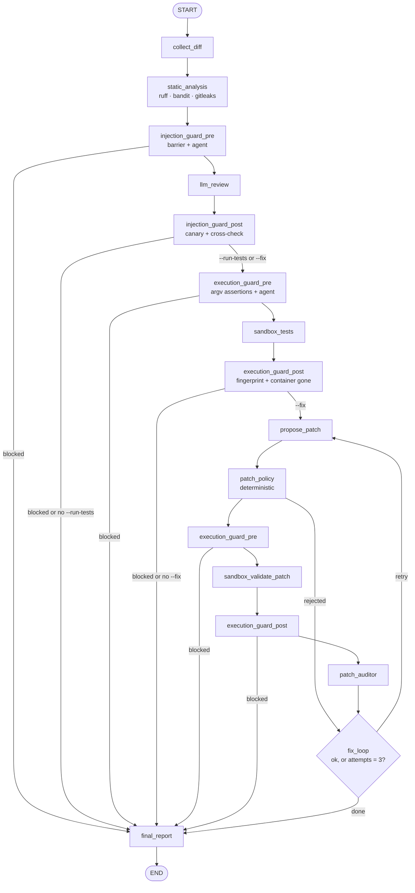

# git-reviewer: architecture plan

Status: plan (phase 1). No tool code exists yet. Every design decision below states its
security rationale; threat IDs (`T-xx`) refer to [SECURITY.md](../SECURITY.md).

## 1. Scope

**v1 does:**
- review the staged diff (default) or a commit range (`--range main..feature`) of a Python project;
- run deterministic static analysis (ruff, bandit, gitleaks) and a local LLM review via Ollama;
- run the project's tests and linter in a Docker sandbox (`--run-tests`);
- propose a patch for a finding, validate it in the sandbox, show it, and apply it to the
  working tree only after explicit confirmation (`--fix`);
- install a pre-commit hook (blocking or warning mode).

**v1 does not:**
- support other languages (the analyzer and sandbox runner are behind interfaces so they can be added later);
- talk to any LLM other than a loopback Ollama instance, or to any other network service;
- read configuration from the reviewed repository (see §9);
- commit, push or stage anything, ever;
- support Windows (path and Docker semantics differ; revisit after v1).

## 2. Trust boundaries

```
 TRUSTED                                   | UNTRUSTED (data only, never instructions)
 ------------------------------------------+---------------------------------------------------
 CLI flags, user config, env of the user   | diff content: code, comments, strings, file names
 git-reviewer code and its pinned deps     | every file of the reviewed ref (tests, conftest.py,
 our own configs for ruff/bandit/gitleaks  |   pyproject.toml, .gitattributes, tool configs, symlinks)
 the sandbox image built from our Dockerfile | all LLM output (reviewer, patch author, guardians)
 the local Docker daemon, local Ollama     | everything produced inside the sandbox (test output,
                                           |   exit codes, linter output)
```

Rules that follow from the boundary:

1. Untrusted data flows *through* the graph but never chooses an effect. Only deterministic
   code decides what to run, what to write and whether to block.
2. Effects live in exactly seven modules: `proc` (subprocess), `git.snapshot` (exports the
   reviewed files into a private temp dir for the scanners), `git.worktree`, `sandbox.docker`,
   `patch.apply`, `hook.install` (writes `.git/hooks`) and `report.write` (report and log files).
   Nothing else may spawn a process or write outside a private temp dir. A unit test enforces this
   by scanning every other module for `subprocess`, `os.system`, `shutil.rmtree`, `open(..., "w"/"a"/"x")`,
   `Path.write_*`, `os.replace`, `os.rename`, `os.chmod` and `os.symlink`.
3. LLM-backed components (reviewer, patch author, guardians) can only *add* findings, alerts or
   blocks. Nothing they return can remove a block or authorize an action (T-30).

## 3. Package layout

```
src/git_reviewer/
  __init__.py          # forces LangChain/LangSmith tracing off before anything imports langchain (T-25)
  cli.py               # Typer app: review, install-hook, uninstall-hook, doctor
  config.py            # Pydantic settings: CLI > env (GIT_REVIEWER_*) > user config file; hard bounds
  models.py            # Pydantic models crossing boundaries: Finding, Report, GuardianVerdict, PatchProposal…
  proc.py              # the ONLY subprocess entry point (allowlist, absolute paths, no shell, clean env)
  sanitize.py          # control/ANSI/bidi stripping for display, secret masking
  audit_log.py         # allowlisted structured log fields (never code, output or secrets)
  git/
    diff.py            # collect diff, parse hunks into a DiffIndex {path -> added line numbers}
    refs.py            # validate refs with `rev-parse --verify --end-of-options`
    snapshot.py        # exports the reviewed version of changed files for the scanners
    worktree.py        # private temp worktree lifecycle, symlink neutralization
  static/
    tools.py           # ruff, bandit, gitleaks with OUR configs, suppressions ignored
    analyze.py         # findings on added lines + own checks (suppression markers, config edits)
    gitleaks.toml      # gitleaks built-in rules, nothing from the reviewed repo
  llm/
    ollama.py          # loopback URL check, model presence, cloud-model refusal, client factory
    prompts.py         # system prompts, nonce delimiters, canary token
    structured.py      # one call -> raw string -> strict Pydantic validation; no repair
  guardians/
    base.py            # fail-closed runner, verdict combination, decision log
    barriers.py        # deterministic checks: unicode, encoded blobs, AI-addressed phrases, docker argv
    injection.py execution.py patch_auditor.py
  sandbox/
    docker.py          # build the docker argv, run, kill, remove, verify removal
    policy.py          # assertions on the argv actually built (execution guardian barrier)
    fingerprint.py     # hash of the user's working tree + .git control files
  patch/
    author.py          # LLM patch proposal (structured edits, not free-form diffs)
    policy.py          # deterministic path rules (final say)
    checks.py          # deterministic AST checks: new imports, network calls, weakened tests
    apply.py           # confirmation, TOCTOU re-checks, git apply to the working tree
  graph/
    state.py nodes.py build.py
  report/
    render.py          # text / json / markdown renderers over sanitized data
    write.py           # the only writer of report and log files, outside the working tree
  hook/
    install.py         # install / chain / refuse / uninstall
    pre-commit.sh.tmpl
sandbox/Dockerfile     # sandbox image: base pinned by digest, tools installed with hashes
scripts/eval_guardians.py   # guardian detection / false-positive metrics (dev tool, not shipped)
tests/
  unit/                # fast, no Docker, no Ollama (LLM calls faked)
  security/            # attack tests; Docker-backed ones marked `docker`
    fixtures/          # malicious DATA files, never collected or imported (see §15)
  guardians/
    datasets/{injection,execution,patch}/{malicious,clean}/*.json
```

## 4. CLI

| Command | Purpose |
|---|---|
| `git-reviewer review [--range A..B] [--run-tests] [--fix] [--format text\|json] [--mode block\|warn]` | Run the review graph. |
| `git-reviewer install-hook [--mode block\|warn] [--chain]` | Install the pre-commit hook (§13). |
| `git-reviewer uninstall-hook` | Remove our hook, restore a chained one. |
| `git-reviewer doctor [--cleanup]` | Check Ollama (local, models present, not cloud), Docker (local endpoint), the sandbox image, gitleaks; list or clean stale worktrees and containers. |

`--fix` implies `--run-tests`: a patch is only shown after it passed the sandbox validation.

The tool never builds or pulls the sandbox image: that needs the network, and the spec allows no
network call except to Ollama. The user builds it once with a documented `docker build` command (§8.2).

Security blocks (barrier, guardian, canary, unsafe paths) exit 2 even in warn mode: warn mode only
turns findings and resource limits into warnings.

Exit codes: `0` nothing at or above the threshold, `1` findings at or above the threshold (block mode),
`2` blocked by a security control (barrier, guardian, policy), `3` usage or configuration error,
`4` required environment missing (Docker or Ollama), never silently downgraded to a host run.

## 5. Review graph (LangGraph 1.2.x)

Checked against the LangGraph docs on 2026-10-23 (`langgraph` 1.2.16): `StateGraph(State,
context_schema=...)`, `add_node`, `add_edge`, `add_conditional_edges`, `START`/`END`,
`compile()`, `Command(goto=..., update=...)`, `recursion_limit` as a top-level config key.
Re-check before writing the graph in phase 3.



Design rules:

- **State.** A `TypedDict` (recommended by the docs for performance), but every value that
  crosses a trust boundary is a frozen Pydantic model validated when it is created.
  `blocks` and `alerts` use an append-only reducer (`operator.add` on tuples); no node has an
  API to remove one.
- **Routing is deterministic.** Conditional edges read only typed state (`blocks`, flags,
  `fix_attempts`), never LLM text. Any block routes straight to `final_report`.
- **Fix loop.** `fix_attempts` is incremented by the graph and capped at 3 by a conditional
  edge; `recursion_limit` is also set explicitly (e.g. 60) as a second bound.
- **No persistent checkpointer.** Checkpoints would write code and diffs to disk. The graph is
  compiled without one; the patch confirmation happens in the CLI after the graph returns, so
  `interrupt()` is not needed.
- **Static analysis runs before any LLM** so its findings are fixed before untrusted text is
  shown to a model, and the cross-check has a ground truth.

## 6. Handling untrusted input

### 6.1 Diff collection
- `--range A..B` reviews what B adds on top of A: `git diff <merge-base(A,B)> B`, like a pull
  request. Any other form (`A...B`, a single ref) is a usage error.
- Refs from `--range` are validated with `git rev-parse --verify --end-of-options <ref>^{commit}`
  and then used as object IDs only (T-21).
- Diffs also pass `--no-relative --ignore-submodules=none --submodule=short` and
  `-c diff.suppressBlankEmpty=false`, so neither a branch's `.gitmodules` (`ignore = all`) nor local
  config can hide a change or shift line numbers; every hunk's line counts are checked against its
  header, and a mismatch stops the review.
- Every git call on untrusted content uses `--no-ext-diff --no-textconv --no-color` (plus
  `--binary` for the staged diff that is replayed in the worktree, §8.1),
  `-c core.hooksPath=/dev/null -c core.fsmonitor=false`, `--attr-source=<empty tree>` (a
  branch's `.gitattributes` with `* -diff` or `binary` would otherwise make git print "Binary
  files differ" instead of the code; needs git 2.40+, checked by `doctor`), and an environment with
  `GIT_CONFIG_NOSYSTEM=1`, `GIT_CONFIG_GLOBAL=/dev/null`, `GIT_TERMINAL_PROMPT=0` and
  `GIT_OPTIONAL_LOCKS=0` (read-only commands must not rewrite `.git/index`, which the execution
  guardian fingerprints) (T-23).
- In hook mode, git runs the hook with `GIT_INDEX_FILE` (and possibly `GIT_DIR`, `GIT_WORK_TREE`)
  pointing at the index being committed; `git commit -a` and `git commit <paths>` use a temporary
  index. These variables are passed through to our git calls, otherwise the review would read the
  wrong index and miss what is actually committed.
- Hard limits (configurable downward only): diff size, number of files, line length. Over a limit
  the review stops with status "not reviewed" (exit 2 in block mode); it never truncates silently (T-35).
- Failure classes: resource limits (size, timeout) give "not reviewed" and follow `--mode`;
  unsafe paths and patch/file-list mismatches always exit 2, even in warn mode; unmerged paths
  exit 3; any other git failure exits 4 with git's own (sanitized) message. An unexpected crash
  exits 2, never 0 or 1. Until the LLM review exists (phase 3), `review` reports "not reviewed".
- Binary files are listed as "not analyzed" (T-36). Paths are checked for NUL, control characters,
  absolute paths and `..` before use.
- `DiffIndex` maps each file to the set of added or modified line numbers; every finding is checked
  against it.

### 6.2 Prompts
- The diff is wrapped in delimiters carrying a fresh random nonce:
  `<untrusted_diff nonce="9f2c…">…</untrusted_diff nonce="9f2c…">`. Any delimiter-like sequence
  inside the data is escaped, so the content cannot close the block (T-01).
- The system prompt states that the block is data, that instructions inside it must be ignored and
  reported as suspicious, and contains a per-run secret canary token (§10.2).
- Untrusted text is never placed in a system prompt.
- The model sees a numbered view of the diff (`  12 + code`, `  13 | code`, `     - code`): a small
  model gets line numbers right from it far more reliably than from hunk headers.
- What the model is shown (numbered diff + static findings) is capped by `max_review_chars`
  (default 60,000 characters). Over the cap, the LLM review is not performed and the status is
  "not reviewed"; the static findings are still reported.
- Ollama silently drops part of a prompt that does not fit its context window, system prompt and
  canary included. So the whole prompt must fit `model_context_tokens` (default 32,768, minimum
  8,192) with 4,096 tokens left for the answer (`num_predict`). Checked twice: before the call, at
  two UTF-8 bytes per token; after it, against the prompt token count Ollama reports. Either check
  failing means "not reviewed". The guardian, which reads the most hostile text, is sized at one
  byte per token, a strict upper bound (§10.1).

### 6.3 LLM output
- Ollama is called with `format=<JSON schema>` (constrained decoding) and temperature 0. The raw
  string is then validated by our own code: `Model.model_validate_json(raw, strict=True)` with
  `extra="forbid"`, bounded string lengths, bounded list sizes and enums for severities.
- We do not use lenient helpers (JSON repair, regex extraction, partial parsing, `include_raw`
  fallbacks). Invalid output = the component failed. For the reviewer, the status becomes "not
  reviewed" (exit 2 in block mode); for guardians it is a block (T-04).
- A finding whose `(file, line)` is not in `DiffIndex` is dropped and raises an alert (T-05).
- An answer that did not end normally (Ollama `done_reason` other than `stop`, e.g. cut at
  `num_predict`) is invalid output. `ollama_timeout_seconds` bounds the whole call, not only each
  network read.
- Only model failures (connection, HTTP, Ollama errors, timeout) and invalid output give "not
  reviewed". Any other exception is a bug in git-reviewer and crashes (exit 2), so it can never pass
  as "not reviewed" with exit 0 in warn mode.

### 6.4 Static analysis (phase 3)
- `git.snapshot` exports the reviewed version of every changed regular file (staged blobs, or blobs
  at the head of the range, read with `git cat-file --batch`) into a private temp dir (0700, files
  0600, created with `O_EXCL|O_NOFOLLOW`). Symlinks and submodules are never materialized; two paths
  colliding on a case-insensitive file system stop the review.
- Python files are recognized by suffix (`.py`, `.pyi`, `.pyw`) and by a `python` shebang, so a
  script named `bin/deploy` is scanned too.
- ruff: `--isolated --ignore-noqa --no-cache --no-respect-gitignore`, rules `E9,F,B,PLE`, and every
  file passed explicitly, so its default excludes (`dist/`, `build/`, `venv/`...) hide nothing.
  bandit: explicit files (no `.bandit` discovery), `--ignore-nosec` and an empty `--exclude=`: its
  default excludes match by substring, so `.git` would hide `.github/` and `CVS` would hide
  `CVSexport.py`. bandit's metrics must list every file it was given, or the analysis fails.
  gitleaks: our `gitleaks.toml` (built-in rules, but without the default global path allowlist,
  which skips `node_modules/`, lockfiles, PDFs and images), an empty ignore directory,
  `--ignore-gitleaks-allow`; a `.gitleaksignore` from the branch is never exported.
- A scanner that exits without its JSON output (even empty) is a failure (exit 4), never "no
  findings".
- Git paths are always literal (`--literal-pathspecs`): a file named `:(exclude)payload.py` would
  otherwise be pathspec magic that removes `payload.py` from the list of files to scan.
- Only findings on added lines are kept. git-reviewer adds its own findings for added suppression
  markers (`# noqa`, `# nosec`, `gitleaks:allow`) and for edits to scanner configuration.
- Secret values never appear in findings: gitleaks messages name the rule only, bandit's
  hardcoded-password messages (which quote the value) are replaced, and every message is masked
  with the gitleaks values.
- Integrity checks, so nothing escapes the scanners silently (T-07, T-36):
  - a scanner finding beyond the last line git shows for a file means git and Python disagree on
    where lines end (a lone carriage return, an exotic encoding) → **block**;
  - a PEP 263 encoding declaration other than UTF-8, ASCII or Latin-1 → **block**: with `utf-7` or
    `unicode_escape`, Python decodes code that git, ruff and the model only see as a comment;
  - an added or changed executable binary (`.pyc`, `.pyo`, `.pyd`, `.so`, `.dylib`, `.dll`, `.whl`,
    `.egg`, `.zip`, `.pth`) → **block**;
  - any other binary file, or a Python file bandit could not parse → "not reviewed": part of the
    change was not analyzed. The barrier and guardian still run; the LLM review does not.
- The report shows how many files each scanner analyzed (`coverage`), so a scanner that saw nothing
  is visible.

### 6.5 Display
- Everything shown in a terminal goes through `sanitize.for_terminal()`: C0/C1 controls (except
  newline and tab) and ANSI/OSC sequences are removed, bidi and invisible characters are shown as
  `U+202E`-style escapes, length is capped. Rich markup in untrusted text is escaped (T-06).

## 7. Subprocess policy (`proc.run`)
- `shell=False` always; argv is a `list[str]`; `stdin=DEVNULL` unless data is passed explicitly.
- Allowlisted binaries: `git`, `docker`, `gitleaks`, `lsof` (only for the Ollama listener check, §9,
  with a fixed argv), plus `ruff` and `bandit` from our own virtualenv.
  They are resolved once at startup to absolute paths, from a fixed list of directories; relative
  PATH entries are rejected and a binary located inside the reviewed repository is refused (T-22).
- Environment: built from scratch (fixed `PATH`, `LANG=C.UTF-8`, the git variables of §6.1). The
  user's environment is never inherited; the only pass-through is the hook-mode git variables of §6.1.
- Every call has a timeout and an output cap; untrusted values come after `--end-of-options` or `--` (T-21).

## 8. Sandbox

### 8.1 Workspace
- A private temp dir (`mkdtemp`, mode 0700) holds a detached worktree created with hooks disabled:
  `git -c core.hooksPath=/dev/null worktree add --detach <tmp>/wt <commit>`. In staged mode the
  staged diff is then applied inside the worktree. The user's working directory is never mounted.
- The worktree contains committed and staged content only, so untracked files such as `.env` are
  not exposed to the tests (T-11).
- Symlinks whose target resolves outside the worktree are removed from the copy and reported as
  findings (T-18). They would dangle inside the container anyway; removing them also protects
  our own host-side reads.
- Cleanup in `finally`: `git worktree remove --force`, `git worktree prune`, temp dir removal.
  `doctor --cleanup` handles leftovers after a crash.

### 8.2 Image
- Built from `sandbox/Dockerfile`: base `python:3.12-slim` pinned by digest, pytest and ruff
  installed from a hashed requirements file, user `10001:10001`. The user builds it once with the
  `docker build` command documented in the README.
- A locally built image has no registry digest, and a tag can be repointed by anything on the
  machine. So `doctor` records the **local image ID** (`sha256:…` from `docker image inspect`) in the
  user config after the build, and every run uses that ID, re-checked with `docker image inspect`
  just before `docker run`.
- **Dependencies of the reviewed project are never installed from the reviewed ref.** Installing them
  would run build code from the attacker with network access. The README documents how to build a
  derived image from a requirements file the user exports from a ref they trust (default: the base
  branch), wheels only and hashes required, so no `setup.py` runs during the build.
- Trade-off: if the reviewed diff changes dependencies, the tests run with the trusted set and may
  fail. The report says so explicitly ("dependency change detected: tests ran with base dependencies").

### 8.3 Container command
The argv built by `sandbox.docker`, asserted field by field by `sandbox.policy` before running:

```
docker --host unix:///<validated socket path>
run --rm --pull=never --init
  --name gr-<uuid> --label git-reviewer.run=<uuid>
  --network=none
  --user=10001:10001
  --read-only --tmpfs /tmp:rw,noexec,nosuid,nodev,size=256m
  --mount type=bind,source=<tmp>/wt,target=/work,readonly
  --workdir=/work
  --cap-drop=ALL --security-opt=no-new-privileges
  --pids-limit=256 --memory=1g --memory-swap=1g --cpus=1
  --env HOME=/tmp --env PYTHONDONTWRITEBYTECODE=1 --env PYTHONPATH=/work/src:/work
  sha256:<local image id recorded by doctor>
  <runner> pytest|ruff
```

- Only the explicit `--env` values above, each in `NAME=VALUE` form; no `--env-file`. A bare
  `--env NAME` makes Docker copy the host's value, so the policy rejects it.
- No mount other than the read-only worktree: no home, `~/.ssh`, `~/.aws`, Docker socket.
- A host-side wall-clock timeout runs `docker kill`, then `docker rm -f` in `finally`; the post
  guardian checks that no container with the run label remains (T-12, T-14).
- The Docker endpoint is resolved once (from `DOCKER_HOST` or the current context in
  `~/.docker/config.json`, e.g. `~/.docker/run/docker.sock` with Docker Desktop) and must be a local
  Unix socket; `tcp://` and `ssh://` are refused, because the code would leave the machine (T-17).
  Every `docker` call then gets `--host unix://<that socket>` and `DOCKER_CONFIG` pointing at an empty
  private dir, so the endpoint used is the endpoint validated; `sandbox.policy` asserts `--host` too.
- If Docker is missing or unreachable, the command exits with code 4. There is no host fallback (T-16).
- Test results are untrusted: test code can fake a pass (`os._exit(0)`, conftest hooks). They are a
  quality signal for the user, never a security decision (T-34).

## 9. Configuration
- Sources, highest first: CLI flags, `GIT_REVIEWER_*` environment variables, the user config file
  (`~/.config/git-reviewer/config.toml`). **No configuration is read from the reviewed repository**
  in v1: a malicious branch could otherwise point `ollama_url` at a remote host or loosen limits (T-27).
- Keys: `ollama_url`, `reviewer_model`, `guardian_model` (separate from the reviewer, as the spec
  requires), timeouts, size limits, sandbox resources, severity threshold. Security limits have
  hard upper bounds in code.
- Defaults to settle in phase 2: reviewer `qwen2.5-coder:7b` (fits a 16 GB machine; `:14b` if
  memory allows). The guardian model should come from a different model family, so an injection
  tuned for one model is less likely to fool both; the choice is driven by the red-team metrics.
- **Ollama checks at startup:** URL scheme `http`, no credentials, host resolving only to loopback
  addresses; model present in `/api/tags`; cloud models refused (`*-cloud` tags or a remote host
  reported by Ollama), since local Ollama would forward the code; a warning if Ollama listens on
  `0.0.0.0`, based on `OLLAMA_HOST` and `lsof -nP -iTCP:<port> -sTCP:LISTEN`; if `lsof` is missing, the
  warning says the check could not run (T-24).
- **Telemetry:** `git_reviewer/__init__.py` sets `LANGCHAIN_TRACING_V2`, `LANGCHAIN_TRACING` and
  `LANGSMITH_TRACING` to `false` and removes LangSmith API keys and endpoints from `os.environ` before
  any LangChain import. A test asserts it, and a test-wide socket guard fails on any non-loopback
  connection, and on the Ollama port itself: tests use a fake model (T-25). Note: `langsmith` is a
  transitive dependency of `langchain-core`; it is installed but its tracing is forced off.
- **Proxies:** the Ollama client runs in our own process and httpx honors `HTTP_PROXY`,
  `HTTPS_PROXY` and `ALL_PROXY` by default, which would send prompts (the code) to a proxy even with a
  loopback `ollama_url`. The client is created with `trust_env=False` and an explicit `base_url`
  (so `OLLAMA_HOST` cannot override it), and `__init__.py` also removes `*_PROXY`/`*_proxy`
  variables. Tested with `HTTPS_PROXY` set (T-24).

## 10. Guardians

### 10.0 Common runner
- Output schema (strict): `{verdict: "ok" | "suspect" | "block", reasons: [str ≤ 300 chars, ≤ 10],
  lines: [{file, line} ≤ 50]}`.
- `run_guardian()` wraps every call: exception, timeout, invalid JSON or schema violation → `block`
  with a reason code (fail-closed).
- Isolation: own system prompt, no tools, no reviewer history; it receives only its input bundle.
- Combination is monotonic: `final = max(deterministic, guardian)` over `ok < suspect < block`. A
  guardian can raise an alert (`suspect`) or block; its `ok` never lowers a deterministic decision.
- Every decision goes to the security report and the log: guardian, verdict, reason codes, line
  refs, duration. No code, no secrets (reasons are masked and truncated before display).

### 10.1 Anti-injection guardian
Before the review:
- Barrier, on every line shown to the model (added, unchanged, removed) and every file name:
  - bidi controls (U+202A–202E, U+2066–2069, U+200E/F, U+061C) and Unicode tag characters
    (U+E0000–E007F) → **block**: never legitimate in code;
  - other invisible or format characters (zero-width, joiners, variation selectors, Hangul fillers)
    → suspect: they also occur legitimately, e.g. in emoji sequences. A BOM at the start of a file
    is accepted;
  - base64 (≥ 40 chars) or hex (≥ 64 chars) runs that **decode to readable text** → suspect, and the
    decoded text is scanned for AI-addressed phrases. Runs that decode to random bytes (hashes,
    integrity values in lockfiles) carry no message and are ignored, to avoid flooding alerts;
  - AI-addressed phrases, after NFKC + casefold + invisible-character removal, in English, French,
    Spanish and German, also across three consecutive lines (split instructions) → suspect;
  - text imitating our data delimiters (`untrusted_…`, `nonce=`) → suspect;
  - a carriage return inside a line (not the CR of a CRLF ending) → **block**: git splits lines on
    LF only, but Python also ends a line at a lone CR, so code can hide in what git, the scanners'
    line mapping and the model see as a comment.
  - Not implemented yet: mixed-script identifier (homoglyph) detection; NFKC only folds
    compatibility forms such as fullwidth letters (T-07 residual).
- Agent: called only when the barrier says "suspect" (a block is already final). It receives the
  flagged lines with one neighbour on each side, nonce-delimited, and may raise to "block". Line
  references it returns that it was not shown are dropped.
- The passages are sent in batches of at most 20,000 UTF-8 bytes, fewer when the context window is
  small (every token is at least one byte, so a batch always fits next to the system prompt and the
  answer). Nothing is truncated: more than 5 batches, or a single line too long for one batch, is a
  **block**, since the guardian could not see everything.

After the review:
- Canary: a random 128-bit token in the reviewer's system prompt; if it appears anywhere in the
  raw output → block. The delimiter nonce appearing in the output → suspect. Both are compared
  after decoding JSON escapes, NFKC, casefold and keeping only letters and digits, so `\u0043ANARY…`,
  `canary - 1F2E…` or fullwidth letters still match.
- Cross-check: for every static finding of severity ≥ medium, the reviewer output must mention that
  `file:line` without lowering it to info/low or calling it a false positive. Otherwise → alert
  "probable injection". Static findings are always in the report whatever the LLM says.

### 10.2 Execution guardian
Before each sandbox run:
- Barrier: `sandbox.policy` asserts the exact argv (§8.3). One deviation → no run.
- Agent: reads test files, `conftest.py`, `setup.py`, `pyproject.toml`, `pytest.ini`, fixtures and
  any `*.pth` / `sitecustomize.py` touched by the diff, and flags network access, subprocesses, reads
  outside the repo, environment harvesting, `eval`/`exec`/`compile`, `__import__`/`getattr` chains,
  encoded payloads. A block means the tests are not run, even in the sandbox (defense in depth
  against container escapes).

After each sandbox run:
- The user's working directory fingerprint (hashes of tracked files, untracked non-ignored files,
  `.git/HEAD`, `.git/config`, `.git/hooks/*` and `.git/index`; symlinks are hashed, not followed) must
  equal the one taken before. Our own `.git/worktrees/<id>` entry is the only expected change.
- No container with the run label exists (`docker ps -a --filter label=…`).

### 10.3 Patch auditor
- Separate component and prompt from the patch author. It receives only the structured finding and
  the patch diff, never the author's reasoning.
- Checks: fixes only the announced finding; no new network call, dependency, import, obfuscation; does
  not weaken tests (removed asserts, `skip`/`xfail`, relaxed tolerances, `try/except` that swallows
  errors, changed expected values).
- `patch.checks` runs the same checks deterministically on the AST before the auditor; `patch.policy`
  runs before both and has the final say.

## 11. Patch flow
1. The author returns **structured edits** (`path`, `start_line`, `end_line`, `replacement`) for one
   finding; we generate the unified diff ourselves, so a malformed diff cannot confuse `git apply`.
2. `patch.policy` (deterministic, final): path must be one of the diff's files; normalized with NFC
   and casefold (macOS file systems are case-insensitive, so `.GIT/config` is `.git/config`); no
   absolute path, `..`, NUL or control characters; `lstat` says regular file, not symlink; resolved
   path stays inside the repo. Denied whatever the diff says: `.git/`, hooks dirs (`.githooks/`,
   `.husky/`), CI (`.github/`, `.gitlab-ci.yml`, `.circleci/`, `Jenkinsfile`, `azure-pipelines.yml`,
   `.travis.yml`, `.pre-commit-config.yaml`), dependency and build files (`pyproject.toml`, `setup.py`,
   `setup.cfg`, `requirements*.txt`, `constraints*.txt`, `uv.lock`, `poetry.lock`, `Pipfile*`,
   `Makefile`, `Dockerfile*`), test infrastructure (`conftest.py`, `pytest.ini`, `tox.ini`, `noxfile.py`),
   Python startup hooks (`sitecustomize.py`, `usercustomize.py`, `*.pth`), tool configs
   (`.git-reviewer*`, `.gitleaks.toml`, `.gitleaksignore`, `ruff.toml`, `.ruff.toml`, `.bandit`),
   files that editors and coding agents load automatically (`.envrc`, `.vscode/`, `.idea/`,
   `.devcontainer/`, `.claude/`, `.cursor/`, `CLAUDE.md`, `AGENTS.md`), and `.gitattributes`, `.gitmodules`.
3. Apply in the temp worktree → execution guards → sandbox validation → deterministic checks →
   auditor. Up to 3 attempts; test failures are fed back to the author only as a sanitized summary
   (test ids and truncated messages inside nonce delimiters), because test output is attacker-controlled.
4. The CLI shows the full diff (sanitized, invisible characters made visible) and asks for a typed
   `yes`. Only on an interactive TTY; never in hook mode or with `--format json`.
5. Before writing: re-run `patch.policy` against the user's tree and check that the target files
   are byte-identical to what was reviewed (TOCTOU). Then `git apply --check` and `git apply` on the
   working tree only (not the index), hooks disabled, never `--unsafe-paths`. No commit, no push.

## 12. Reports and logs
- `Report` (Pydantic) → renderers: text (default), JSON, and an optional Markdown file. Files are
  written by `report.write` **outside the working tree**, in
  `$XDG_STATE_HOME/git-reviewer/reports/<repo hash>/` (directory 0700, files 0600): inside the user's
  repo they would be untracked, easy to commit with `git add -A`, and would change the execution
  guardian's fingerprint. A "Security report" section lists every barrier and guardian decision.
- Secrets: gitleaks findings are captured in memory only. Their values are used to mask any text
  before display (LLM explanations, guardian reasons, test output), then dropped. Displayed secrets
  show the rule, the location and a short hash prefix only.
- Logs: stderr, level WARNING by default, optional file (same state directory, mode 0600, written by
  `report.write`). Log events carry allowlisted
  fields only (event, counts, durations, verdicts, rule ids, file paths); free text from untrusted
  sources is never logged (T-26).

## 13. Git hook
Hook script (rendered at install time, absolute path of the installed binary):

```sh
#!/bin/sh
# Installed by git-reviewer: reviews the staged diff before each commit.
# Mode: block (a finding at or above the threshold stops the commit).
# Skip once: git commit --no-verify
# Remove:    git-reviewer uninstall-hook
exec "/absolute/path/to/git-reviewer" review --hook --mode block
```

- The hook location comes from `git rev-parse --git-path hooks` (handles worktrees).
- Existing `pre-commit` hook: refuse by default. With `--chain`, rename it to
  `pre-commit.chained-by-git-reviewer` and generate a hook that runs it first and stops on its
  failure; `uninstall-hook` restores it. If the existing hook is a symlink, or `core.hooksPath` is
  set (husky, pre-commit framework), refuse and print manual instructions.
- `--mode warn` prints the report and always exits 0.
- In hook mode: non-interactive, no patch application, sandbox tests only if enabled in the user config.
- `--no-verify` skips the hook. The hook is a convenience for the user, not a security boundary.

## 14. Supply chain and CI
- Runtime dependencies: `typer`, `pydantic`, `langgraph`, `langchain-ollama` (and their transitive
  deps). Dev: `pytest`, `ruff`, `bandit`, `pip-audit`. Anything else needs a written justification.
- `uv.lock` committed (it records hashes); installs use `uv sync --locked`.
- CI (GitHub Actions, added in phase 2): actions pinned by commit SHA, `permissions: contents: read`,
  `uv sync --locked`, ruff, pytest (unit + security, Docker available on the Linux runner), bandit on
  `src/`, pip-audit on the locked environment. gitleaks pinned by version and checksum.

## 15. Testing strategy
- `tests/unit`: pure logic, LLM calls faked. `tests/security`: one test per attack in the spec, each
  asserting the attack *fails* (blocked, contained, or rejected).
- **Malicious fixtures are data.** They live in `tests/security/fixtures/` and
  `tests/guardians/datasets/` as `.diff`, `.json` or `.txt` files (never `test_*.py`), excluded via
  pytest `norecursedirs`, and excluded from ruff, bandit and pyright. Only the sandbox ever executes
  them (copied into a worktree), so the host never runs a fork bomb (T-32).
- Docker-backed tests are marked `docker`. When Docker is unavailable they are reported as skipped,
  and `verify` reports skipped security tests as a failure, never as green.
- An autouse fixture blocks any socket connection that is not to loopback.
- Guardian datasets: one JSON file per sample:
  `{id, guardian, label: malicious|clean, technique, description, input: {...}, expected}`.
  `scripts/eval_guardians.py` computes, per guardian, detection rate on malicious samples and
  false-positive rate on clean ones, and lists the misses. The `red-team` skill writes these into
  `SECURITY.md` between markers.

## 16. Phase map

| Phase | Delivers |
|---|---|
| 2 | `pyproject.toml` + `uv.lock`, CI, `cli.py`, `config.py`, `proc.py`, `git/diff.py`, `git/refs.py`, `llm/ollama.py` checks, telemetry off, socket guard |
| 3 | `static/*`, `llm/prompts.py`, `llm/structured.py`, `graph/*` without sandbox, `report/*`, `sanitize.py`, injection guardian |
| 4 | `git/worktree.py`, `sandbox/*`, `sandbox/Dockerfile`, execution guardian |
| 5 | `patch/*`, patch auditor, fix loop |
| 6 | `hook/*` |
| 7 | full security suite, guardian datasets ≥ 20 per guardian, `/red-team`, `/security-gate`, final audit |
